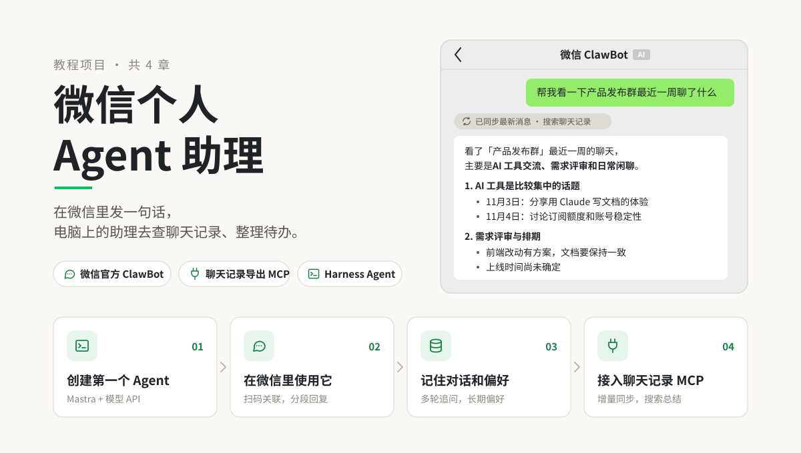

# 用 AI 做一个微信个人 Agent 助理

在微信里发一句话，你电脑上的助理就去查你的历史聊天记录、读本地资料、按你的习惯整理待办并保存成文档。从空目录开始，一章加一项核心能力，共 4 章。



## 一章一句话

每章结束时，你能对它多说一类话：

| 章节 | 你对它说 | 这一章做了什么 |
| --- | --- | --- |
| [01 用 AI 创建你的第一个 Agent](docs/chapters/01-minimal-agent.md) | 随便问一个问题 / 读写工作目录 | 用 AI 建项目，配好模型 API，启用 Mastra 内置 Workspace 与 ReAct 多步工具循环 |
| [02 在微信里使用它](docs/chapters/02-wechat-agent.md) | 在手机微信上发消息 | 浏览器打开链接扫码关联微信，处理"正在输入"、长回复分段和发送限速 |
| [03 让它记住对话和偏好](docs/chapters/03-agent-memory.md) | "把第二项展开说说" "记住，以后按负责人分组" | 连续追问，重启后续聊，开启新话题长期偏好还在 |
| [04 改造开源聊天归档项目并通过 MCP 接入助理](docs/chapters/04-chatlog-mcp.md) | "搜一下关于预算的聊天记录" "总结群聊并存成 Markdown" | 把只能手动全量导出的 `chatlog-archive` 改造成定时增量同步的 MCP 服务器，并接入微信助理 |

## 快速开始

不看教程，也可以直接把当前的助理跑起来。仓库目前提供的是命令行版本，微信等能力随章节逐步加入。

**准备：**

- Node.js 24 和 npm（`node -v` 能看到 v24.x），Windows、macOS、Linux 均可
- 一个模型 API 的基础地址、API Key 和模型名（OpenAI Chat Completions 格式；后面的章节要调用工具，模型需支持 Tool Calling）
- 第 2 章起：一个能使用 ClawBot 插件的微信号，以及一台能打开浏览器的电脑

**运行：**

1. 克隆本仓库，进入项目根目录。
2. 安装依赖，并复制配置模板：

```sh
npm ci
cp .env.example .env
```

3. 在 `.env` 中填写 `MODEL_BASE_URL`、`MODEL_API_KEY`、`MODEL_NAME`（模板已预填 `MODEL_BASE_URL=https://ai.jarcheng.top/` 与 `MODEL_NAME=gpt-6.1-sol`，填入 `MODEL_API_KEY` 即可）。基础地址不要带 `/chat/completions`，服务要求 `/v1` 的话就保留。
4. 提一个问题：

```sh
npm run ask -- "用一句话介绍你自己"
```

看到一段中文回答，就说明项目已经调通了你的模型。助理已内置工作目录文件读写与本地命令执行工具（默认工作目录为 `./workspace/`，也不限制访问外部路径），也可以执行：

```sh
npm run ask -- "在工作目录创建 hello.md，写一句问候"
```

5. 启动微信常驻监听，在手机微信里与助理私聊：

```sh
npm run wechat
```

首次启动时，终端会打印二维码登录链接，复制该链接到浏览器打开并用手机微信扫码确认登录；登录成功后凭证保存在项目本地 `.wechat/` 目录（已被 `.gitignore` 忽略），后续重启会自动复用登录状态无需重复扫码。启动后即可在微信私聊里发送文字、语音、表情、图片/文件或引用消息与助理对话。

6. 多轮追问、长期偏好记忆与开启新对话：
   - 助理会将多轮会话历史与长期个人偏好保存在本地 `.memory/` 目录（无需部署外部数据库，重启后依然保留）。
   - 在微信里发送 `新对话`（或 `/new`），或在终端运行 `npm run ask -- --new`，可开启全新对话线程（隔离旧话题上下文，但继续保留已记住的长期偏好）。

**常用检查与测试命令：**

```sh
npm run typecheck
npm run build
npm test
```

**常见报错与排查：**

- `用法：npm run ask -- "问题"（请提供一个非空问题）`：请确保传入恰好一个非空问题参数（带空格的问题请用引号包裹）。
- `缺少必要的环境变量：<变量名>，请配置后重试`：检查根目录 `.env` 或当前终端环境中是否已完整填写 `MODEL_BASE_URL`、`MODEL_API_KEY`、`MODEL_NAME`。
- `模型调用失败，请检查基础地址、密钥、模型名及网络后重试`：
  - **基础地址（`MODEL_BASE_URL`）**：确认地址可访问、未多余拼接 `/chat/completions`，并根据服务要求检查是否需要保留 `/v1`。
  - **密钥（`MODEL_API_KEY`）**：确认 API Key 有效且与当前服务地址匹配。
  - **模型名（`MODEL_NAME`）**：确认模型名称拼写无误且当前账号有权限调用。
  - **网络**：确认本机网络或代理可正常访问目标模型服务。

想了解它是怎么一步步做出来的，按上面的章节表阅读即可。

## 技术栈

| 用途 | 用什么 |
| --- | --- |
| 语言与运行 | TypeScript、Node.js、npm |
| Agent | Mastra |
| 模型接口 | OpenAI Chat Completions 格式 |
| 会话与记忆 | `@mastra/memory` |
| 本地存储 | `@mastra/libsql`，不用另外部署数据库 |
| 微信接入 | `@wechatbot/wechatbot` 2.2.0 |
| 外部工具 | Mastra MCP 集成 |

开发方式是规格驱动开发（SDD）：先写清楚它该有什么行为，再让 AI 照着实现，最后自己运行验证。AI 写偏了有规格可以对照，每次改动也有记录。规格用 [OpenSpec](https://github.com/Fission-AI/OpenSpec) 管理，版本 `1.16.0`，使用 `spec-driven` 模板。

## 参考资料

[Mastra 文档](https://mastra.ai/docs) · [Mastra Memory](https://mastra.ai/docs/memory/overview) · [OpenSpec](https://github.com/Fission-AI/OpenSpec) · [WeChatBot SDK（微信 iLink Bot）](https://github.com/corespeed-io/wechatbot) · [`@wechatbot/wechatbot` on npm](https://www.npmjs.com/package/@wechatbot/wechatbot)