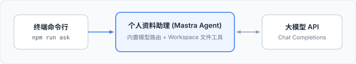

# 01 用 AI 创建你的第一个 Agent

这一章从空目录开始，不到半小时，你会得到一个能在终端里回答问题的 Agent。我们会用一个最小的案例，把"先写规格、再让 AI 实现、最后自己验收"的完整流程走一遍。后面每一章都重复这个流程。

## 完成后你会得到

```
$ npm run ask -- "用一句话介绍你自己"
我是你的个人资料助理，可以回答问题并帮你读写工作目录下的文件。
```



这一章不做微信、记忆和定时任务，只确认两件事：**项目能调通你的模型，并且自带工作目录文件读写能力。**

## 开始前

- Node.js 24 和 npm（`node -v` 能看到 v24.x）
- 一个能改文件、跑命令的 AI 编程工具
- 模型 API 的基础地址、API Key 和模型名

## 第 1 步：让 AI 创建项目骨架

新建空目录，用 AI 编程工具打开，发给它：

```
在当前空目录里创建一个 TypeScript + Node.js 项目，要求：
- 使用 npm，Node 版本 24
- 添加 .gitignore，忽略 node_modules、.env、日志和本地数据库文件
- 暂时不写任何业务代码，也不安装 Agent 相关的依赖
完成后告诉我生成了哪些文件。
```

**检查：** 目录里有 `package.json`、`tsconfig.json`、`.gitignore`。

## 第 2 步：初始化 OpenSpec

接下来用 [OpenSpec](https://github.com/Fission-AI/OpenSpec) 管理需求。这一步自己在终端里做：

```bash
npm install -g @fission-ai/openspec@1.16.0
openspec init
```

初始化时会让你选择正在使用的 AI 编程工具。它会做两件事：

- 在项目里创建 `openspec/` 目录，后面的需求和变更记录都放在这里
- 在你的工具目录（如 `.agents/skills/`）里装入一组 **skill**

skill 可以理解为一份份写好的"工作说明书"，告诉 AI 在某个环节该怎么做事。OpenSpec 装进去的这些，分别对应"提案、实施、归档"等环节，后面会逐个用到。

装完后**重启你的 AI 编程工具**，让新装的 skill 生效。

## 第 3 步：提案

现在开始做第一个功能。在 OpenSpec 里，一次改动叫一个"变更"。给它起个英文短名 `minimal-agent`，然后发给 AI：

```
使用 openspec-propose 提案 minimal-agent：

我要做一个"个人资料助理"，现在做第一个可运行版本：

- 提供命令行入口：npm run ask -- "问题"，把问题发给 Agent，打印回答
- Agent 用 Mastra 创建，名字叫"个人资料助理"，用中文回答，简洁，并开启内置的 Workspace 文件与命令工具（默认工作目录为 ./workspace，不限制访问外部路径）
- 模型通过 OpenAI Chat Completions 格式的 API 调用，地址、密钥、模型名从环境变量读取；生成 .env.example（地址填 https://ai.jarcheng.top/，模型名填 gpt-6.1-sol，密钥留空）
- 缺少任何一个环境变量时，给出明确的中文提示，不要报一长串堆栈
- API Key 不能出现在代码、日志和报错信息里
- 依赖版本要锁定，不使用 latest
- 本变更不包含：多轮会话记忆、微信、定时任务

```

开头的 `openspec-propose` 就是刚才装进去的 skill，这句话让 AI 按它的说明来起草。也可以不点名，直接说"帮我提案 minimal-agent"，AI 一般也会匹配到。（不同工具点名 skill 的方式不同，比如 Codex 里输入 `$` 可以选。）

AI 会在 `openspec/changes/minimal-agent/` 下生成一组文件。注意，这时**还没有任何代码**。

## 第 4 步：阅读规格

这是整章最重要的一步，不要跳过。AI 写代码之前，先确认它理解的和你想的一致。打开刚生成的目录，里面的文件各有分工：

| 文件 | 回答什么问题 | 你怎么读 |
| --- | --- | --- |
| `proposal.md` | 为什么做、改什么 | 扫一遍，确认范围和你的意图一致 |
| `specs/` | 系统应该有什么行为 | **重点读**，这是验收的依据 |
| `design.md` | 技术上打算怎么做 | 看一下选型，比如用了哪些包 |
| `tasks.md` | 实施分几步 | 看颗粒度，应该是一串小步骤的勾选清单 |

`specs/` 里的规格通常写成"需求 + 场景"：一条需求下面有几个具体场景，描述"在什么情况下，应该看到什么结果"。你只需要问自己：这些场景，我能不能亲手验证？

重点检查三处：

1. **范围**：有没有悄悄加了你没要求的功能，"不包含"的部分有没有保留
2. **两条保护**：缺少环境变量时的中文提示、密钥不外露，有没有变成具体场景
3. **任务清单**：是不是几个小步骤，而不是一大坨

不满意就直接告诉 AI 改，比如"把日志相关的内容删掉"。改到你认可，再往下走。

## 第 5 步：实施

规格确认后，才轮到写代码：

```
使用 openspec-apply-change 实施 minimal-agent
```

这次用的是另一个 skill：它会让 AI 按 `tasks.md` 的清单逐项实现，做完一项勾掉一项。

**检查：** 大致会多出这几样东西（文件名不必和教程一致）：

- 一个定义 Agent 的文件
- 一个命令行入口
- 一个 `.env.example`，预填了示例地址和模型名，没有真实密钥
- `package.json` 里多了 `ask` 脚本，依赖版本没有 `^` 或 `latest`

## 第 6 步：配置你的 API Key

把 `.env.example` 复制为 `.env`，填入你的 `MODEL_API_KEY`：

```
MODEL_BASE_URL=https://ai.jarcheng.top/
MODEL_API_KEY=你的 API Key
MODEL_NAME=gpt-6.1-sol
```

> 变量名以 AI 实际生成的 `.env.example` 为准。

三条规矩：

- 密钥只写在 `.env` 里，不要发给 AI，不要写进规格和提示词
- 提交前确认 `.env` 被忽略（`git status` 里看不到它）
- 密钥泄露过，去服务商后台作废重建

## 第 7 步：运行验收

```bash
npm run ask -- "用一句话介绍你自己"
```

对照第 4 步读过的规格场景，逐条验：

| 检查项 | 预期 |
| --- | --- |
| 正常调用 | 收到一段中文回答，是模型真实生成的 |
| 工作目录读写 | 运行 `npm run ask -- "在工作目录创建 hello.md，写一句问候"`，能看到 `./workspace/hello.md` 被成功创建 |
| 缺少配置 | 删掉 `.env` 里的 `MODEL_NAME` 再运行，看到明确的中文提示，没有堆栈 |
| 密钥保护 | 全局搜一下，代码和终端输出里都没有你的 Key |

有一项不通过，就把现象告诉 AI，让它按规格修，修完重新验。**全部通过再进入下一步。**

## 第 8 步：归档

测试没问题，这次变更就完成了。最后一个 skill 负责收尾：

```
使用 openspec-archive-change 归档 minimal-agent
```

归档会把 `openspec/changes/minimal-agent/` 移到 `openspec/changes/archive/`，按日期命名，留作历史。同时，这次变更里的规格会合并进 `openspec/specs/`。你可以把 `specs/` 看作"系统现在是什么样"的记录，下一次提案时，AI 就是以它为基础来改的。

**检查：** `openspec/changes/` 下不再有进行中的 `minimal-agent`，`openspec/specs/` 里多了 Agent 相关的规格。

## 小结

这一章你走完了一整个流程：

**提案 → 读规格 → 实施 → 自己验收 → 归档**

项目有了骨架，Agent 能回答问题，密钥放在了安全的地方。后面每一章都是同样的节奏，只是每次提案的内容不同。

下一章：把这个 Agent 接到微信里。
