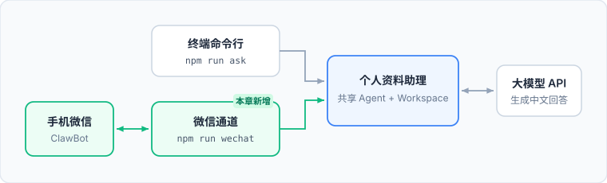

# 02 在微信里使用它

上一章的 Agent 只能在终端里一问一答。这一章我们把它接到微信里，让你在手机上发消息，电脑上的 Agent 收到后调用模型并回复你。流程和第一章完全一样：**提案 → 读规格 → 实施 → 自己验收 → 归档**。

## 完成后你会得到

在电脑终端启动微信助理：

```
$ npm run wechat
正在等待微信扫码登录……
（首次运行打开终端输出的登录链接，用手机微信扫码确认连接）
微信已连接，正在监听消息……
```

接着在手机微信里打开 **微信 ClawBot** 对话框：

```
我：用一句话介绍你自己
（顶部显示"对方正在输入..."）
助理：我是你的个人资料助理，目前可以在微信里回答你的问题。
```

这一章只把收发消息的通道打通，并处理好微信聊天特有的体验细节（正在输入、长文分段、发送限速）。多轮记忆和定时任务留到后面几章。



> **注意：发消息有限制。** 单条消息上限 4000 字符，发得太快会被微信拒收（报 `prepare failed`）。本章按实测结果取保守值：回复超过 2000 字符就分条发，相邻两条间隔不少于 1.5 秒。

## 开始前

- 已完成第 1 章，`npm run ask -- "问题"` 能正常返回中文回答
- 第 1 章的变更 `minimal-agent` 已经归档（`openspec/specs/` 下已有基础规格）
- 手机微信已升级到支持 **ClawBot** 插件的版本（iOS 8.0.70 及以上，或已获得灰度入口的最新安卓/鸿蒙版本）

## 第 1 步：提案

这次变更起名叫 `wechat-agent`。在 AI 编程工具里发给它：

```
使用 openspec-propose 提案 wechat-agent：

我要把现有的"个人资料助理"接入微信，要求：

- 提供命令行入口：npm run wechat，启动微信监听常驻进程；原有的 npm run ask 保持可用
- 使用 @wechatbot/wechatbot，版本锁定为 2.2.0。首次运行时通过 bot.login({ callbacks }) 在终端输出登录链接，扫码登录后凭证保存在本地 .wechat/ 目录并被 Git 忽略，下次启动自动复用
- 支持所有类型的微信私聊消息：忽略群聊与机器人自身消息（登录凭证中 accountId 为机器人 ID，userId 为扫码用户自身 ID，切勿过滤 userId）；收到文字、语音（直接使用微信自带转写后的 msg.text）、图片、文件、视频以及引用消息（msg.quotedMessage）时，先调用 bot.sendTyping(msg.userId) 触发并维持微信"正在输入"状态直到回复发送完毕，把消息文本或媒体链接/路径一并交给现有的个人资料助理 Agent 生成回复
- 处理长回复与发送限速：回复超过 2000 字符就按段落或句子切分成多条依次发送，相邻两条消息间隔不少于 1.5 秒；若遇到微信频控报错 prepare failed，等待 5 秒后重试一次
- 单次模型调用或消息发送失败时，向用户回复简短中文错误提示，进程保持运行不退出
- API Key 和微信登录凭证不能出现在代码、日志、终端输出和发给用户的消息里
- 依赖版本要锁定，不使用 latest
- 本变更不包含：多轮会话记忆、偏好记忆、定时任务、群聊
```

AI 会在 `openspec/changes/wechat-agent/` 下生成提案、规格、设计和任务清单。

## 第 2 步：阅读规格


打开 `openspec/changes/wechat-agent/`，在让 AI 写代码前重点检查四处：

1. **原有能力有没有被破坏**：`specs/` 里是否保留或兼容了第 1 章的 `npm run ask` 和 Agent 基础配置，而不是推倒重写。
2. **微信交互的边界条件**：
   - "正在输入"状态是不是在调模型前触发，并维持到回复完成
   - 语音（直接取微信转写好的 `msg.text`）、图片/文件/视频（传递媒体链接或路径）和引用消息是不是都能交给 Agent 处理
   - 超长回复怎么切分（超过 2000 字符分条、优先在换行或句号处断开）、相邻两条间隔不少于 1.5 秒、遇到 `prepare failed` 退避重试，有没有写成明确的场景
3. **常驻进程的容错**：命令行 `ask` 报错可以退出，但微信监听是常驻进程——单次请求报错后，进程不能崩，下一条消息还得能正常收发。
4. **凭证安全**：`@wechatbot/wechatbot` 生成的本地凭证文件存放在哪里，有没有明确写进 `.gitignore`。

如果有遗漏（比如 AI 没写清楚长消息按 2000 字符切分、1.5 秒间隔，或者漏掉了忽略凭证文件），直接让 AI 用 `openspec-update-change` 补充修改，确认无误再进入下一步。

## 第 3 步：实施

规格确认后，发给 AI：

```
使用 openspec-apply-change 实施 wechat-agent
```

AI 会按 `tasks.md` 逐步安装 `@wechatbot/wechatbot@2.2.0`、编写微信接入与消息分段限速逻辑、新增 `wechat` 启动脚本并补充测试。

**检查：**

- `package.json` 里新增了 `wechat` 脚本，`@wechatbot/wechatbot` 版本锁定为 `2.2.0`（无 `^` 或 `latest`）
- `.gitignore` 里增加了微信本地登录凭证目录或文件的忽略规则
- 原有的 `npm run ask -- "用一句话介绍你自己"` 依然能正常运行

## 第 4 步：扫码登录与运行验收

在终端启动微信助理：

```bash
npm run wechat
```

首次启动时，终端会输出登录链接。复制链接到浏览器打开并用手机微信扫一扫，确认连接后，微信消息列表里会出现 **微信 ClawBot**。

打开对话框，对照规格逐项验收：

| 检查项 | 你的操作 | 预期 |
| --- | --- | --- |
| 文字与语音问答 | 打字或直接按住发语音："用一句话介绍你自己" | 手机顶部短暂显示"正在输入"，随后收到简洁的中文回复（微信自带语音转文字，无需额外部署语音模型） |
| 长回复分段与限速 | 发送"详细列出 20 条提升专注力的具体建议，每条展开讲讲" | 超过 2000 字符的回复被切分成多条按顺序发出，相邻两条间隔不少于 1.5 秒，不报 `prepare failed` |
| 图片或文件消息 | 发送一张图片或一个文件 | 媒体信息正常传给 Agent 并收到中文回复，终端进程不崩溃 |
| 重启复用登录 | 在终端按 `Ctrl + C` 停止，再次运行 `npm run wechat` | 不需要重新扫码，直接进入消息监听状态 |
| 原有命令行 | 另开终端运行 `npm run ask -- "你好"` | 依然正常打印回答并退出 |
| 凭证与密钥保护 | 运行 `git status` | 看不到 `.env` 和微信登录凭证文件 |

> **提示：** 这一章还没有加记忆能力，所以你发的两条消息之间是独立的，它还不记得上一句聊了什么。这是正常的，下一章马上解决。

如果有任何一项不符合预期（例如长消息没分段、发图片导致进程退出），把终端表现发给 AI 让它修复，全部验过再归档。

## 第 5 步：归档

验收通过后，把这次变更归档：

```
使用 openspec-archive-change 归档 wechat-agent
```

**检查：** `openspec/changes/wechat-agent/` 已移入 `openspec/changes/archive/`，`openspec/specs/` 中合并了微信接入相关的规格。

## 常见问题

- **发送消息报错 `prepare failed`**：单条消息超过了 4000 字符上限，或连续多条消息发得太快被微信拒收。检查分段阈值是否设为 2000 字符以内、相邻两条发送间隔是否不少于 1.5 秒。
- **扫码后提示无权限或找不到 ClawBot**：确认手机微信已升级到支持版本；部分账号处于灰度放量中，需在微信"我 → 设置 → 插件"中确认是否可用。
- **登录凭证过期、收不到消息**：删除本地保存的微信凭证文件（位置见你的 `design.md` 或 `.gitignore`），重新运行 `npm run wechat` 打开登录链接扫码即可。
- **模型响应慢时"正在输入"消失了**：微信单次"正在输入"状态只维持几秒，可以让 AI 在模型生成期间定时续期该状态，直到回复发出。

## 小结

现在你的 Agent 已经住进微信里了。你在手机上发一句话，电脑上的程序收到后显示"正在输入"，调用模型，再把长短不一的回答稳妥地发回手机。

但如果你接着问一句"把刚才第二点展开说说"，它会一头雾水——因为每次问答还是独立的。

下一章：给它加上会话历史和长期偏好，让它真正记住你们聊过什么。
