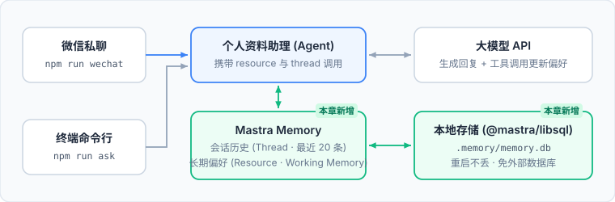
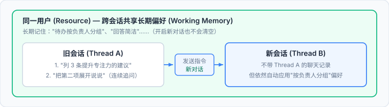

# 03 让它记住对话和偏好

上一章我们把助理接进了微信，但每发一条消息还是一次独立的问答——你问"把刚才第二点展开说说"，它根本不知道上一句聊了什么。这一章我们用 `@mastra/memory` 和本地存储 `@mastra/libsql` 给它加上两层记忆：**当前话题的会话历史**，以及**跨话题的长期个人偏好**。流程依然不变：**提案 → 读规格 → 实施 → 自己验收 → 归档**。

## 完成后你会得到

在微信里和 **微信 ClawBot** 连续对话：

```
我：给我列 3 条提升专注力的建议，每条一句话
助理：1. 每次只做一件事，关闭无关通知……
      2. 用 25 分钟番茄钟切分工作块……
      3. 提前一晚写好第二天最重要的三件事……

我：把第二项展开说说
助理：第 2 条"25 分钟番茄钟"具体可以这样做：……

我：记住，以后整理待办都按负责人分组
助理：好，记下了，以后整理待办会默认按负责人分组。

我：新对话
助理：已开启新对话，之前的长期偏好依然保留。

我：帮我整理这几项待办：张三准备投影仪，李四负责签到，张三还要联系场地
助理：按负责人整理如下：
      - 张三：准备投影仪、联系场地
      - 李四：负责签到
```

即使在电脑终端按 `Ctrl + C` 停止 `npm run wechat` 再重新启动，之前的对话记录和记住的偏好也不会丢失。



> **提示：两种记忆的区别。** Mastra 用两个标识区分记忆层级：`thread`（会话线程）管"当前这一轮话题聊了什么"，开启新对话就会换一个新的 `thread`；`resource`（用户身份）管"你是谁、有什么长期习惯"，通过 Working Memory（工作记忆）跨所有对话持续生效。

## 开始前

- 已完成第 2 章，`npm run wechat` 和 `npm run ask -- "问题"` 都能正常工作
- 第 2 章的变更 `wechat-agent` 已经归档（`openspec/specs/` 下已有基础与微信接入规格）
- 当前配置的模型支持 **Tool Calling**（Mastra 的长期偏好记忆通过内置工具自动更新）

## 第 1 步：提案

这次变更起名叫 `agent-memory`。在 AI 编程工具里发给它：

```
使用 openspec-propose 提案 agent-memory：

我要给现有的"个人资料助理"加上多轮会话历史和长期偏好记忆，要求：

- 引入 @mastra/memory（锁定版本 1.41.0）和 @mastra/libsql（锁定版本 1.29.0），使用 LibSQLStore（显式指定 id，数据库文件存放在项目本地 .memory/memory.db，确保初始化前自动创建 .memory/ 目录）持久化记忆，无需额外部署数据库；把 .memory/ 加入 .gitignore
- 为个人资料助理 Agent 挂载 Memory：
  - 开启会话历史（lastMessages: 20），按 thread 保存与加载多轮对话上下文，支持连续追问和重启后续聊
  - 开启跨会话的长期偏好记忆（workingMemory: { enabled: true, scope: 'resource', template: ... }），提供简洁的中文 Markdown 偏好模板（包含称呼、回复风格、整理习惯等），并在 Agent 指令中说明当用户提出"记住……"或表达长期偏好时主动更新工作记忆；显式关闭或不启用 semanticRecall，不引入额外的向量 Embedding 接口依赖
- 微信端（npm run wechat）支持连续对话与开启新话题：
  - 以微信私聊发送方 msg.userId 作为 resource，在本地 .memory/ 下持久化记录每个用户当前活跃的 threadId，使进程重启后仍能接着上一轮继续聊
  - 按用户串行排队处理消息，并将下载的图片作为多模态 image 内容（Data URL）随 user 消息传给 Agent 并存入会话历史，确保"先发一张图、紧接着再发文字追问"时不会并发冲突且能直接识别历史图片（切勿让模型用 read_file 工具读图片，因为 OpenAI 兼容接口仅支持在 user 消息中传图片）
  - 当用户发送"新对话"或"/new"时，直接为该用户切换一个新的 threadId 并持久化，回复简短中文确认（不调用大模型），隔离旧话题聊天记录，但保留该 resource 下的长期偏好
- 命令行端（npm run ask）支持记忆与新对话：
  - 原有 npm run ask -- "问题" 保持可用，默认复用固定的本地命令行 resource 与当前活跃 threadId，使多次执行 npm run ask 也能连续追问并共享长期偏好
  - 支持 npm run ask -- --new（或发送"新对话" / "/new"）切换新的命令行会话 threadId 并打印中文确认
- API Key、微信登录凭证不能出现在代码、日志、终端输出和发给用户的消息里
- 依赖版本要锁定，不使用 latest、^ 或 ~
- 本变更不包含：向量语义检索（Semantic Recall）、定时任务、MCP 外部工具
```

AI 会在 `openspec/changes/agent-memory/` 下生成提案、规格、设计和任务清单。

## 第 2 步：阅读规格



打开 `openspec/changes/agent-memory/`，在让 AI 写代码前重点检查四处：

1. **两种记忆的作用域有没有分清**：
   - 会话历史（`lastMessages: 20`）绑定在 `thread` 上，负责"把第二项展开说说"这类上下文追问
   - 长期偏好（`workingMemory`）的 `scope` 必须是 `'resource'`，负责跨对话记住"以后按负责人分组"这类个人习惯
2. **"新对话"的行为边界**：发送 `新对话` 或 `/new` 时，只切换当前活跃的 `threadId`，**不能**清空 `resource` 下的 `workingMemory`；同时不需要调大模型，直接返回一句中文确认即可。
3. **重启后的状态恢复**：不仅聊天消息存进 `.memory/memory.db`，每个用户"当前正在用哪个 `threadId`"的映射也要保存在本地，否则重启 `npm run wechat` 后又会变成新会话，没法续聊。
4. **有没有额外引入不需要的依赖**：确认 `design.md` 里没有开启 `semanticRecall`（否则运行时会报错要求配置 Embedding 向量模型），并且 `LibSQLStore` 传入了必填的 `id` 字段。

如果发现哪里不对（比如把 `workingMemory` 的 `scope` 写成了 `'thread'`，或者漏掉了持久化当前 `threadId`），让 AI 用 `openspec-update-change` 修正后再继续。

## 第 3 步：实施

规格确认无误后，发给 AI：

```
使用 openspec-apply-change 实施 agent-memory
```

AI 会按 `tasks.md` 安装 `@mastra/memory@1.41.0` 和 `@mastra/libsql@1.29.0`、为 Agent 配置 `Memory` 与 `LibSQLStore`、在微信和命令行入口接入 `resource` / `thread` 管理与"新对话"指令，并补充自动化测试。

**检查：**

- `package.json` 里新增了 `@mastra/memory`（`1.41.0`）和 `@mastra/libsql`（`1.29.0`），版本号无 `^`、`~` 或 `latest`
- `.gitignore` 里已忽略 `.memory/` 目录
- `npm test` 全部通过

## 第 4 步：运行验收

启动微信助理：

```bash
npm run wechat
```

打开手机上的 **微信 ClawBot** 对话框，按顺序完成下面 6 项验收：

| 检查项 | 你的操作 | 预期 |
| --- | --- | --- |
| 1. 连续追问 | 先发"列 3 条提升专注力的建议，每条一句话"，收到回复后再发"把第二项展开说说" | 助理能准确围绕刚才的第 2 条建议展开说明 |
| 2. 记住长期偏好 | 发送"记住，以后整理待办都按负责人分组" | 助理回复确认已记住该偏好 |
| 3. 重启后续聊 | 在终端按 `Ctrl + C` 停止，再次运行 `npm run wechat`，在微信里问"我们刚才聊的第 1 条建议是什么？" | 重启后依然记得停止前聊过的第 1 条建议 |
| 4. 开新话题隔离上下文 | 发送 `新对话`（或 `/new`），收到确认后再问"刚才让你展开说的第二项是什么？" | 助理立即回复已开启新对话；再问旧话题细节时，它表示这是新对话、不清楚上一轮的具体条目 |
| 5. 新话题下偏好仍在 | 在新对话里发送"帮我整理待办：张三准备投影仪，李四负责签到，张三还要联系场地" | 即使换了新话题，助理依然自动**按负责人分组**输出待办 |
| 6. 命令行与文件保护 | 另开终端运行 `npm run ask -- "你好"`，再运行 `git status` | 命令行正常返回中文回答；`git status` 里看不到 `.memory/`、`.wechat/` 和 `.env` |

如果某一项不符合预期（比如开启新对话后连长期偏好也忘了，或者重启后不记得上一轮聊了什么），把现象发给 AI 修复，全部验过再归档。

## 第 5 步：归档

验收通过后，把这次变更归档：

```
使用 openspec-archive-change 归档 agent-memory
```

**检查：** `openspec/changes/agent-memory/` 已移入 `openspec/changes/archive/`，`openspec/specs/` 中已合并记忆相关的规格。

## 小结

现在你的助理不再是"聊完上句忘下句"了：

- 同一场对话里，你可以自然地追问"把第二项展开说说"
- 退出重启后，它还能接着上次的话往下聊
- 你交代过的习惯（比如"按负责人分组"），哪怕发一句 `新对话` 开启全新话题，它依然牢牢记得

下一章：改造开源聊天归档项目 `chatlog-archive`，让它支持后台定时增量同步并对外提供 MCP 服务，再接入你的微信个人助理。
