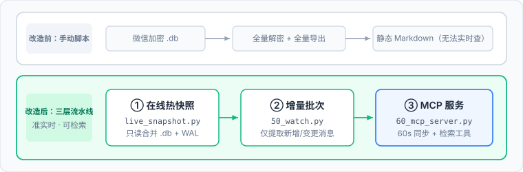
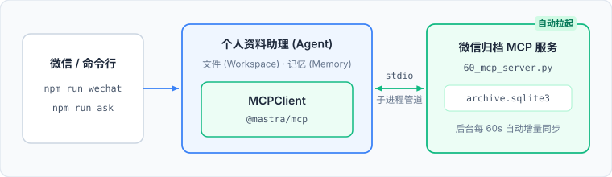
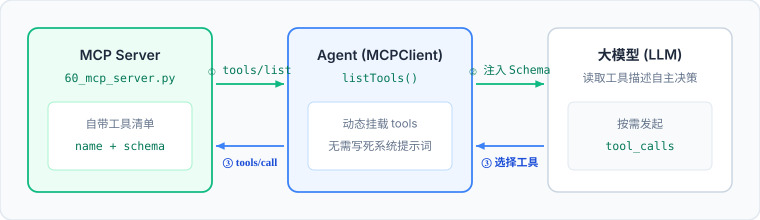

# 04 改造开源聊天归档项目并通过 MCP 接入助理

前三章我们搭起了个人资料助理（工作区文件读写 + 微信私聊通道 + 会话历史与长期偏好记忆）。最后一章，我们把外部开源工具 [chatlog-archive](https://github.com/qifan/chatlog-archive)（本机微信聊天记录解密归档工具）改造成 **MCP（Model Context Protocol）服务**，并通过 `@mastra/mcp` 动态接入个人助理。

## 完成后你会得到

在手机微信里和 **微信 ClawBot** 对话：

```
我：看一下我的微信聊天归档库现在有多少个会话、多少条消息？
助理：当前归档库共有 548 个会话、318,033 条消息。

我：帮我看一下N5小队这个群最近一周聊了什么
助理：看了"N5小队欣欣向荣" 10 月 30 日至 11 月 5 日的聊天，主要聊了这些：
      - AI 工具与使用排障：讨论 Claude 文档体验与 Antigravity 代理配置……
      - 工作与考勤：智能体平台 4A 登录、微信打卡补签与 SDD 流程……
      - 优惠券与周末活动：兴业银行朴朴券、草地活动与团建路线……

我：把上面整理的内容保存成 workspace 下的 group-weekly.md
助理：已按你的偏好整理并保存至 workspace/group-weekly.md。
```

---

## 第一部分：改造 `chatlog-archive` 为 MCP 服务

### 架构演进：从手动脚本到三层增量流水线

原始的 `chatlog-archive` 只能手动按顺序跑脚本做全量导出，既拿不到微信 `-wal` 里刚收到的新消息，也无法供 Agent 实时按需检索。我们用三层流水线把它改造成准实时的 MCP 服务：



- **① 在线热快照（`live_snapshot.py`）**：只读拷贝微信 `.db` 与 `-wal`，合并已提交的新消息，绝不干扰正在运行的微信。
- **② 增量消息批次（`50_watch.py`）**：对比分片指纹与消息哈希，只把新增或变更的消息发布为增量批次。
- **③ 定时同步 + MCP 服务（`60_mcp_server.py`）**：后台线程每 60 秒自动增量同步入库，主线程通过 `stdio` 暴露检索与同步工具。

### 让 AI 完成改造

前置条件：已在 `chatlog-archive` 中配置好 `config.json`，并运行过一次 `20_get_keys.py` 生成 `work/wechat/keys.json`。

在 `chatlog-archive` 目录下发给 AI：

```
请在现有 chatlog-archive 项目的 scripts/wechat/ 下新增在线增量同步与 MCP Server 能力（保持对原微信数据库完全只读）：

1. 新增 scripts/wechat/live_snapshot.py：
   - 提供 source_version(path) 读取 .db 与 -wal 的文件指纹（ino, size, mtime_ns, ctime_ns）
   - 提供 snapshot(source, dest, key_info)：将加密 .db 与 -wal 复制到临时文件（复制前后指纹不一致则报错重试），使用 key_info 解密主库每一页并校验页尾 HMAC-SHA512，再解析 -wal 校验帧头与滚动校验和，将已提交事务的加密 WAL 页解密写回对应页号，最后用 sqlite3 immutable 模式执行 PRAGMA quick_check 验证快照完整性
2. 新增 scripts/wechat/50_watch.py：
   - 使用 work/wechat/live/state.sqlite3 保存已同步分片状态与每条消息的哈希（id -> hash）及待发布批次队列（batches 表）
   - Watcher.poll() 仅对指纹变化的 message_[0-9]*.db 分片调用 snapshot 解密，复用 40_export.py 的联系人解析与消息解压渲染逻辑，将新增或变化的消息写入 batches 表，再以 .tmp -> 原子 replace 的方式发布到 work/wechat/live/batches/%012d.jsonl
   - 支持 --interval、--once、--emit-history 参数，并用文件锁 watch.lock 防止并发写冲突
3. 新增 scripts/wechat/60_mcp_server.py：
   - 实现 ArchiveStore（存储在 work/wechat/live/archive.sqlite3）：首次运行自动全量拉取历史并消费 batches/*.jsonl 写入 chat_messages、chats 汇总表与 messages_fts (FTS5) 表；提供 sync_now()、get_status()、list_chats()、search_messages()、get_chat_messages()、get_recent_messages()（消息列表仅返回紧凑的核心字段 t/from/text，单次查询上限 200 条）
   - 启动后台守护线程每隔 --interval（默认 60 秒）自动执行一次增量同步（调试日志输出到 stderr）
   - 在主线程实现零外部依赖的 stdio MCP JSON-RPC 2.0 服务端（支持 initialize、ping、tools/list、tools/call），暴露 wechat_sync_now、wechat_status、wechat_list_chats、wechat_search_messages、wechat_get_chat_messages、wechat_get_recent_messages 六个工具；同时支持 --sync-once 与 --rebuild 命令行参数
```

改造完成后，跑一条命令建立初始归档索引：

```bash
python3 scripts/wechat/60_mcp_server.py --sync-once
```

---

## 第二部分：通过 MCP 动态接入个人助理

### 整体架构与动态工具发现



我们采用本地 MCP 标准的 **`stdio` 子进程托管模式**：只需启动个人助理（`npm run wechat` 或 `npm run ask`），助理内部的 `MCPClient` 会自动把 `60_mcp_server.py` 作为子进程拉起（常驻期间后台每 60 秒自动增量同步，无需手动单独启动 MCP Server）。



> **提示：为什么不需要把 MCP 工具写死进系统提示词？**
> 如上图所示，`MCPClient.listTools()` 在握手阶段通过 `tools/list` 自动拿到外部工具的名称、描述与参数 Schema 并注入给大模型。模型直接根据协议描述自主选择工具，Agent 的系统提示词完全无需硬编码具体工具名。

### 第 1 步：提案

回到本项目的 `harness-tutorial` 目录，按 **提案 → 读规格 → 实施 → 自己验收 → 归档** 流程把 MCP 接进来。发给 AI：

```
使用 openspec-propose 提案 chatlog-mcp：

我要通过 @mastra/mcp 将外部的 chatlog-archive 微信聊天记录 MCP 服务器（60_mcp_server.py）接入现有的"个人资料助理"，要求：

- 引入 @mastra/mcp（版本锁定为 2.8.0，不使用 latest、^ 或 ~）
- 配置与环境变量：
  - 支持从环境变量或 .env 读取可选的 CHATLOG_MCP_SCRIPT（指向 chatlog-archive 的 scripts/wechat/60_mcp_server.py 绝对路径）和可选的 CHATLOG_PYTHON_BIN（默认 python3）；在 .env.example 中补充说明注释
  - 当未配置 CHATLOG_MCP_SCRIPT 或脚本文件不存在时，助理保持原有全部能力正常工作，不报错崩溃
  - 当配置了有效的 CHATLOG_MCP_SCRIPT 时，使用 @mastra/mcp 的 MCPClient 通过 stdio（command: CHATLOG_PYTHON_BIN, args: [CHATLOG_MCP_SCRIPT]）连接该 MCP 服务器，获取其工具集并挂载给个人资料助理 Agent
- 生命周期、动态工具挂载与多步循环：
  - 通过 MCPClient.listTools() 动态发现并挂载外部 MCP 工具集到个人资料助理 Agent（无需在 Agent 系统指令中硬编码具体 MCP 工具名，直接利用 MCP 协议自身的工具描述与参数 Schema 让模型自主按需调用），并保持与长期偏好（Working Memory）和工作目录文件工具（Workspace）协同工作
  - 将 agent.generate 的多步循环上限设为 maxSteps: 15，并提取最后一个完成步骤的文本作为最终回复（避免中间工具调用步骤的过渡语提前截断回复）
  - 命令行端（npm run ask）单次问答结束后，主动断开 MCPClient 连接（disconnect），避免子进程残留导致命令行挂起不退出；微信常驻端（npm run wechat）在常驻期间复用连接并打印已挂载工具日志
- API Key、微信登录凭证不能出现在代码、日志、终端输出和发给用户的消息里
```

### 第 2 步：阅读规格

打开 `openspec/changes/chatlog-mcp/`，重点确认三项设计边界：

1. **未配置时优雅降级**：未设置 `CHATLOG_MCP_SCRIPT` 时，原有的问答、文件读写、记忆及全部测试照常运行。
2. **单次命令的子进程回收**：`npm run ask` 在 `finally` 中调用了 `disconnect()`，回答完毕后立即释放 Python 子进程；`npm run wechat` 则在常驻期间保持连接复用。
3. **纯动态挂载与多步收敛**：Agent 只挂载 `tools` 而不硬编码提示词，且 `maxSteps` 足够支撑跨多天群聊的分页拉取与最终汇总。

### 第 3 步：实施

确认无误后发给 AI：

```
使用 openspec-apply-change 实施 chatlog-mcp
```

**检查：**

- `package.json` 中 `@mastra/mcp` 版本精确锁定为 `2.8.0`
- `npm run typecheck` 和 `npm test` 全部通过

### 第 4 步：配置与运行验收

在 `.env` 中配置你的 `60_mcp_server.py` 路径：

```ini
CHATLOG_MCP_SCRIPT=/Users/macm/Documents/workspace/clone/chatlog-archive/scripts/wechat/60_mcp_server.py
```

启动微信助理：

```bash
npm run wechat
```

打开手机上的 **微信 ClawBot** 完成验收：

| 检查项 | 你的操作 | 预期 |
| --- | --- | --- |
| 1. 查询归档状态 | 发送"看看我的微信聊天归档库状态" | 返回真实的会话总数、消息总数与最近同步时间 |
| 2. 汇总群聊记录 | 发送"帮我看一下某个群最近一周聊了什么" | 助理自动查群、分页拉取聊天记录并输出完整话题汇总 |
| 3. 检索近期消息 | 在任意微信群或私聊发一句话，再对 ClawBot 发"看看最近 10 分钟我收到了什么微信消息" | 自动触发增量同步并准确读出刚才发的新消息 |
| 4. 跨能力串联 | 发送"把刚才查到的内容整理一下，保存成 workspace 下的 summary.md" | 结合个人偏好整理后写入 `./workspace/summary.md` 并告知路径 |

### 第 5 步：归档

验收通过后归档变更：

```
使用 openspec-archive-change 归档 chatlog-mcp
```

---

## 全书小结

回顾这 4 章，我们始终用同一种节奏（**提案 → 读规格 → 实施 → 自己验收 → 归档**）搭起了一个完整的个人微信 Agent 助理：

1. **第 01 章（底座）**：接通大模型，利用 Mastra 内置的 `Workspace` 与 ReAct 多步循环读写本地文件与执行命令
2. **第 02 章（通道）**：通过微信 ClawBot 把它装进手机，处理好"正在输入"、长消息切分与频控退避
3. **第 03 章（记忆）**：用 `@mastra/memory` + `@mastra/libsql` 区分单次会话历史（`Thread`）与跨话题长期偏好（`Resource Working Memory`）
4. **第 04 章（扩展）**：把开源项目 `chatlog-archive` 改造成定时增量同步的 MCP 服务，通过 `@mastra/mcp` 动态挂载给助理，跑通"查真实聊天记录 → 按个人偏好加工 → 落盘生成文档"的完整闭环
